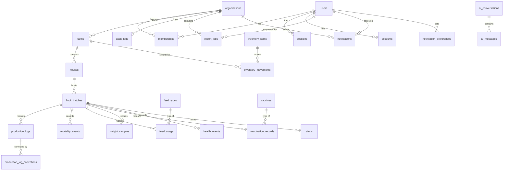

# Data model

The source of truth is [`apps/api/prisma/schema.prisma`](../../apps/api/prisma/schema.prisma).
Constraints that Prisma cannot express live in the migration SQL under
`apps/api/prisma/migrations/`.

## Entity relationships

## Conventions

- **Keys:** UUID primary keys generated by the application.
- **Time:** all instants are `timestamptz` in UTC. Calendar facts (log date, placement date)
  are `date` and are interpreted in the organization's `timezone`.
- **Naming:** snake_case tables and columns; Prisma models map to them with `@@map`/`@map`.
- **Quantities:** counts are `integer`; masses and volumes are `numeric` to avoid float drift.
  Feed is always in kilograms (`quantity_kg`). The API returns numerics as JSON numbers.
- **Mortality causes** are the `mortality_reason` enum (disease, injury, predator, heat stress,
  culled, unknown, other).

## Integrity rules

| Rule                                                                               | How it is enforced                                                                                                                                                                                                            |
| ---------------------------------------------------------------------------------- | ----------------------------------------------------------------------------------------------------------------------------------------------------------------------------------------------------------------------------- |
| **Tenant consistency.** A row can only reference parents in the same organization. | Every tenant-owned parent has `UNIQUE (organization_id, id)`; children reference it with a composite FK `(organization_id, parent_id)`. A house in org A cannot point at a farm in org B, even if application code has a bug. |
| **One production log per batch per day.**                                          | `UNIQUE (organization_id, batch_id, log_date)`                                                                                                                                                                                |
| **One active flock per house.**                                                    | Partial unique index `flock_batches (organization_id, house_id) WHERE status = 'ACTIVE'`                                                                                                                                      |
| **A flock's end date matches its status.**                                         | `CHECK` constraints: `end_date` is set exactly when status is `DEPLETED` or `CLOSED`, and never precedes `placement_date`                                                                                                     |
| **Approval is all-or-nothing.**                                                    | `CHECK`: `approved_by` and `approved_at` are set exactly when a production log is `APPROVED`                                                                                                                                  |
| **One open correction per log, reviewed once.**                                    | Partial unique index on pending corrections; `CHECK`: reviewer and review time set exactly when a correction leaves `PENDING`                                                                                                 |
| **Voids explain themselves.**                                                      | `CHECK` on mortality, feed and weight records: `voided_at`, `voided_by` and `void_reason` are all set or all null                                                                                                             |
| **Transfers are pairs.**                                                           | `CHECK`: `transfer_id` is set exactly on `TRANSFER_IN`/`TRANSFER_OUT` movements; both rows of a transfer share it                                                                                                             |
| **Alert review is recorded consistently.**                                         | `CHECK`: who/when acknowledged and resolved are set together and agree with `status`                                                                                                                                          |
| **Unique batch codes per tenant.**                                                 | `UNIQUE (organization_id, batch_code)`                                                                                                                                                                                        |
| **Non-negative quantities.**                                                       | `CHECK` constraints in the initial migration                                                                                                                                                                                  |
| **Append-only audit history.**                                                     | Trigger rejects `UPDATE` and `DELETE` on `audit_logs`                                                                                                                                                                         |
| **No silent overwrite of approved records.**                                       | Changes go through `production_log_corrections` and are applied only after approval                                                                                                                                           |
| **Inventory integrity.**                                                           | Every stock change is an `inventory_movements` row; balances are derived                                                                                                                                                      |
| **Idempotent jobs.**                                                               | `alerts (organization_id, dedupe_key)` and `report_jobs (organization_id, idempotency_key)` are unique                                                                                                                        |
| **No cascading deletes of history.**                                               | All foreign keys use `ON DELETE RESTRICT`; farms and houses are archived (`archived_at`), never deleted                                                                                                                       |

## Identity tables

`users`, `sessions`, `accounts` and `verifications` are owned by Better Auth
([ADR-0005](../decisions/0005-authentication.md)). They are not tenant-scoped and have no RLS.
Sessions and accounts cascade-delete with their user; nothing else does.

## Deliberate deviations from the original plan

- `ai_messages` carries `organization_id` so it follows the same composite-FK rule as every
  other tenant-owned table. `evidence_metadata` holds an answer's claims, evidence references,
  tool calls and model metadata, never raw tool output. `ai_conversations` gained `title` and
  `updated_at` for the conversation list; CHECKs bound the title (120) and message (8,000)
  lengths.
- `report_jobs` gained `attempts`, `row_count`, `started_at`, `completed_at` and `expires_at`,
  and `job_status` gained `EXPIRED` (the file was deleted after retention). CHECKs require a
  file, row count and expiry on every SUCCEEDED job and cap the stored error at 500
  characters. Rows are private to the requester in the service; RLS scopes them to the
  organization.
- `notifications` (one row per recipient) and `notification_preferences` (per member and
  organization) were added in week 8. `(organization_id, user_id, dedupe_key)` is unique, so
  a retried job can't notify twice. `email_status` (NONE, PENDING, SENT, FAILED) is the email
  outbox. CHECKs bound the title (200) and body (1,000) and allow only in-app links (`/…`).
  Both tables have tenant RLS policies.
- `app_active_organization_ids()` is a `SECURITY DEFINER` function that returns the ids of
  active organizations, so scheduled jobs can visit each tenant without the runtime role
  seeing the `organizations` table across tenants.
- `production_logs` gained `status`, `approved_by` and `approved_at`, and a
  `production_log_corrections` table was added to implement the correction workflow.
- Mortality, feed and weight records gained void columns instead of an edit path
  ([ADR-0008](../decisions/0008-corrections-health-inventory.md)).

## Changing the schema

Edit `schema.prisma`, then run `pnpm db:migration:new <snake_case_name>`. It writes the SQL that
takes the database to the schema, without applying it. Append any raw SQL (CHECK constraints,
partial indexes, policies, grants for new tables), then apply it with
`pnpm --filter @farmos/api prisma:migrate:deploy`. CI fails if the migrations and the schema
drift apart. `prisma migrate dev` is not used; see
[ADR-0006](../decisions/0006-farm-structure.md#consequences).
