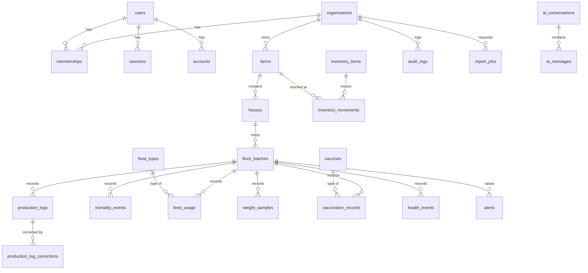

# Data model

The source of truth is [`apps/api/prisma/schema.prisma`](../../apps/api/prisma/schema.prisma).
Constraints that Prisma cannot express live in the migration SQL under
`apps/api/prisma/migrations/`.

## Entity relationships

## Conventions

- **Keys:** UUID primary keys generated by the application.
- **Time:** all instants are `timestamptz` in UTC. Calendar facts (log date, placement date)
  are `date` and are interpreted in the organization's `timezone`.
- **Naming:** snake_case tables and columns; Prisma models map to them with `@@map`/`@map`.
- **Quantities:** counts are `integer`; masses and volumes are `numeric` to avoid float drift.

## Integrity rules

| Rule                                                                               | How it is enforced                                                                                                                                                                                                            |
| ---------------------------------------------------------------------------------- | ----------------------------------------------------------------------------------------------------------------------------------------------------------------------------------------------------------------------------- |
| **Tenant consistency.** A row can only reference parents in the same organization. | Every tenant-owned parent has `UNIQUE (organization_id, id)`; children reference it with a composite FK `(organization_id, parent_id)`. A house in org A cannot point at a farm in org B, even if application code has a bug. |
| **One production log per batch per day.**                                          | `UNIQUE (organization_id, batch_id, log_date)`                                                                                                                                                                                |
| **Unique batch codes per tenant.**                                                 | `UNIQUE (organization_id, batch_code)`                                                                                                                                                                                        |
| **Non-negative quantities.**                                                       | `CHECK` constraints in the initial migration                                                                                                                                                                                  |
| **Append-only audit history.**                                                     | Trigger rejects `UPDATE` and `DELETE` on `audit_logs`                                                                                                                                                                         |
| **No silent overwrite of approved records.**                                       | Changes go through `production_log_corrections` and are applied only after approval                                                                                                                                           |
| **Inventory integrity.**                                                           | Every stock change is an `inventory_movements` row; balances are derived                                                                                                                                                      |
| **Idempotent jobs.**                                                               | `alerts (organization_id, dedupe_key)` and `report_jobs (organization_id, idempotency_key)` are unique                                                                                                                        |
| **No cascading deletes of history.**                                               | All foreign keys use `ON DELETE RESTRICT`; entities are archived via status                                                                                                                                                   |

## Identity tables

`users`, `sessions`, `accounts` and `verifications` are owned by Better Auth
([ADR-0005](../decisions/0005-authentication.md)). They are not tenant-scoped and have no RLS.
Sessions and accounts cascade-delete with their user; nothing else does.

## Deliberate deviations from the original plan

- `ai_messages` carries `organization_id` so it follows the same composite-FK rule as every
  other tenant-owned table.
- `production_logs` gained `status`, `approved_by` and `approved_at`, and a
  `production_log_corrections` table was added to implement the correction workflow.
