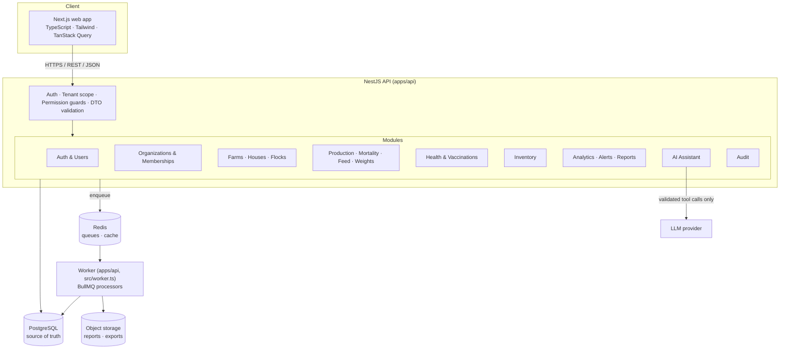

# Architecture overview

FarmOS Intelligence is a **modular monolith**: one deployable API process with strict
module boundaries, a separate background worker, and a Next.js web client. See
[ADR-0001](../decisions/0001-modular-monolith.md) for why.

## Request flow

1. The user authenticates.
2. The API resolves organization membership for the requested tenant.
3. A guard checks the membership's role against the permission matrix
   ([permissions.md](permissions.md)).
4. DTO validation rejects malformed input.
5. A domain service applies business rules.
6. The repository runs tenant-scoped queries; composite foreign keys and row-level
   security back this up in the database.
7. An audit entry and any background work are recorded in the same transaction. Jobs are
   enqueued after the commit, and a sweep recovers any that were lost
   ([ADR-0011](../decisions/0011-background-jobs-and-reports.md)).
8. The API returns a documented response.

The worker is a second entry point of the API codebase rather than its own package: it runs
the same modules (reports, alerts, notifications) without HTTP. See
[reports-and-jobs.md](reports-and-jobs.md).

## Repository layout

| Path                     | Purpose                                                    |
| ------------------------ | ---------------------------------------------------------- |
| `apps/api`               | NestJS API and worker, Prisma schema and migrations        |
| `apps/web`               | Next.js App Router client                                  |
| `packages/shared-types`  | Roles, permissions and DTO contracts shared by API and web |
| `packages/tsconfig`      | Shared TypeScript configuration                            |
| `packages/eslint-config` | Shared ESLint flat config                                  |
| `infra/docker`           | Container images                                           |
| `docs/`                  | Architecture, decisions (ADRs), API docs                   |

## Environments

| Environment | Composition                                                               |
| ----------- | ------------------------------------------------------------------------- |
| Local       | `docker compose` for PostgreSQL + Redis; `pnpm dev`, plus `worker:dev`    |
| CI          | GitHub Actions with a PostgreSQL service container                        |
| Demo        | Managed PostgreSQL, container-hosted API and worker, hosted web (week 10) |
