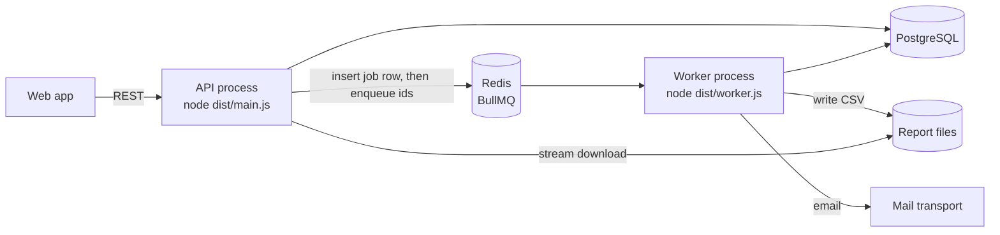
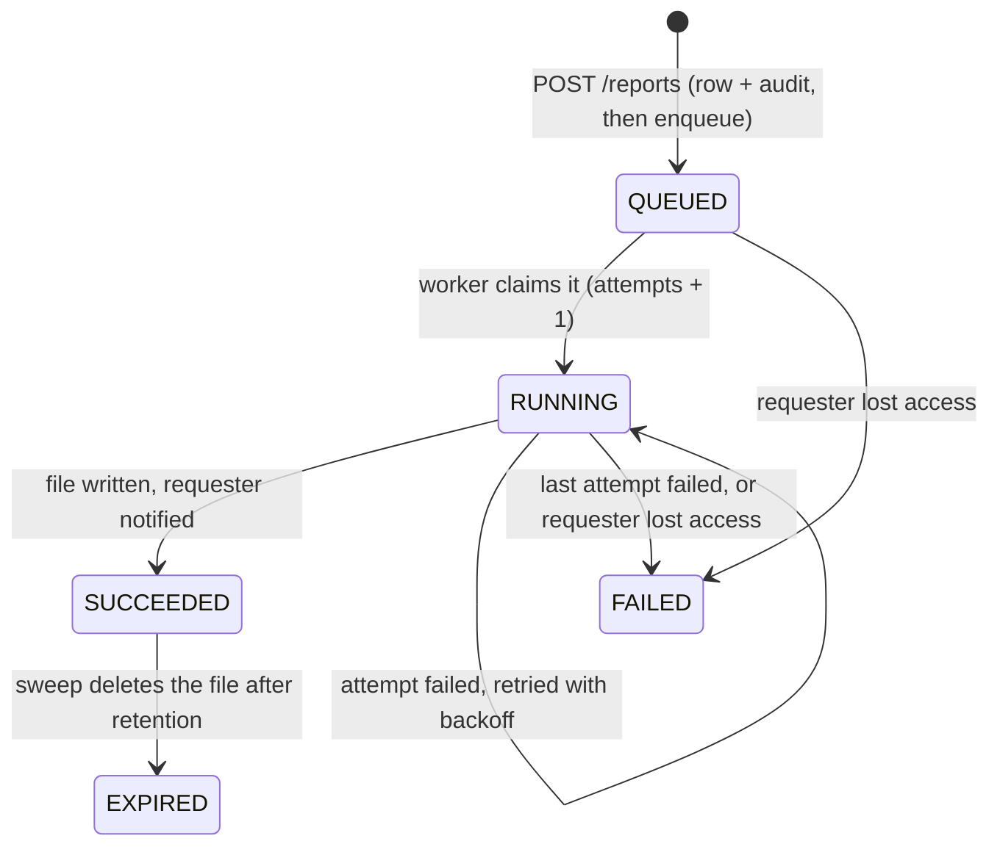

# Reports, background jobs and notifications

Reports turn the records into CSV files. Background jobs generate them, evaluate alerts on a
schedule and send email. Notifications tell members when something needs them. The design and
the alternatives are in [ADR-0011](../decisions/0011-background-jobs-and-reports.md).

Code:

- `apps/api/src/modules/reports`
- `apps/api/src/modules/notifications`
- `apps/api/src/jobs`, `apps/api/src/worker`
- `apps/api/src/storage`, `apps/api/src/mail`

## Processes



Both processes run the same code with the same Nest modules. The worker leaves out HTTP and
adds the queue consumers.

```sh
pnpm --filter @farmos/api dev          # API on :4000
pnpm --filter @farmos/api worker:dev   # worker
```

## Reports

| Type                | Who (any of)                                | Range       | Filters     |
| ------------------- | ------------------------------------------- | ----------- | ----------- |
| `flock_performance` | `reports:view`                              | up to 366 d | farm        |
| `daily_production`  | `reports:view`                              | up to 366 d | farm, flock |
| `mortality`         | `reports:view`                              | up to 366 d | farm, flock |
| `health_events`     | `reports:view`                              | up to 366 d | farm, flock |
| `vaccinations`      | `reports:view`                              | up to 366 d | farm, flock |
| `inventory_stock`   | `reports:view`                              | current     | farm        |
| `alerts`            | `reports:view`                              | up to 366 d | flock       |
| `my_entries`        | `reports:view-limited`, `production:record` | up to 31 d  | (own only)  |

`REPORT_TYPES` in `@farmos/shared-types` is the source of truth; the table above mirrors it.

- **Range:** a missing range means the 30 days ending on the organization's today. Every
  figure comes from the same metric definitions as the dashboard.
- **Two ways to get one:**
  - **Direct export** (`GET /exports/:type`): the CSV comes back in the response. It is
    limited to 92 days and 10,000 rows, and asks you to generate a report when you exceed
    either limit. Export buttons on the dashboard, alerts, inventory and flock pages use it.
  - **Report job** (`POST /reports`): generated by the worker for any range up to its limit.
    It is downloaded from the Reports page and kept for `REPORT_RETENTION_DAYS` (7 by
    default).
- **CSV format:** RFC 4180, CRLF line endings, and a UTF-8 byte order mark so Excel reads
  accents. A cell that starts with `=`, `+`, `-`, `@`, a tab or a carriage return is
  prefixed with `'`. That keeps a note such as `=HYPERLINK(…)` as text in a spreadsheet.
- **Privacy:** a report job, and its file, belong to the member who requested it. Other
  members, owners included, get 404.

### Report job lifecycle



- **Request:** `POST /reports` takes an `idempotencyKey`, which the web form generates once per
  submission. Repeating a request returns the same job with `created: false`. Reusing a key
  for a different report, or as a different member, returns 409.
- **Limit:** a member can have five jobs queued or running at once; a sixth request returns 429.
- **Generation:** the worker re-checks the requester's current role before generating. A
  member who lost access gets the job marked FAILED with "You no longer have access to this
  report.", and no file is written.
- **Failure messages:** only plain messages are stored for the user. Stack traces stay in the
  worker log.

## Jobs

| Job                   | Queue       | Started by                         | Job id (deduplicates)     |
| --------------------- | ----------- | ---------------------------------- | ------------------------- |
| `reports.generate`    | reports     | `POST /reports`, sweep             | `report-<reportJobId>`    |
| `alerts.evaluate-all` | alerts      | scheduler, `ALERT_EVALUATION_CRON` | scheduler                 |
| `alerts.evaluate`     | alerts      | `alerts.evaluate-all`              | `alerts-<org>-<UTC hour>` |
| `email.send`          | email       | a notification with email, sweep   | `email-<notificationId>`  |
| `maintenance.sweep`   | maintenance | scheduler, every 5 minutes         | scheduler                 |

- **Retries:** every job gets three attempts with exponential backoff (5 s, 10 s, 20 s).
- **Payloads** carry ids only; processors reload state from the database.
- **Tenant scope:** every processor works inside one organization's tenant context
  (`withOrganization`). The organizations to visit come from `app_active_organization_ids()`,
  a `SECURITY DEFINER` function that returns only ids.
- **Alerts:** evaluation runs hourly because each organization's "yesterday" ends at a
  different UTC hour. Evaluation is idempotent, so the repeats cost only a query.
- **Sweep:** for each organization, the maintenance sweep
  - re-enqueues report jobs QUEUED for more than 2 minutes;
  - fails jobs RUNNING for more than 30 minutes (their worker died);
  - re-enqueues emails PENDING for more than 5 minutes;
  - deletes expired report files.

## Notifications

| Kind            | Sent to                                                                    | Link                |
| --------------- | -------------------------------------------------------------------------- | ------------------- |
| `alert.raised`  | Members who act on alerts; veterinarians and health staff for health rules | `/alerts`           |
| `report.ready`  | The requester                                                              | `/reports?job=<id>` |
| `report.failed` | The requester                                                              | `/reports?job=<id>` |

- **Alert digests:** an evaluation sends each recipient one summary, for example "3 new alerts
  for 2026-11-10: 1 critical, 2 medium: missing records (2), high daily mortality (1).".
  - Field workers and auditors see alerts in the app but aren't notified.
  - `notifiedOfAlert` in `@farmos/shared-types` decides who is.
- **Privacy and storage:** notifications are private to their recipient. They are stored in the
  same transaction as the event, with a dedupe key so a retried job can't notify twice.
- **Email:**
  - Each member picks per organization: alerts at or above a severity (or none), and their
    own reports (on or off). In-app notifications are always on.
  - An emailed notification starts as PENDING and is queued after the transaction commits.
  - The worker sends it only if it is still PENDING and the recipient is still a member, then
    marks it SENT. After the last failed attempt it marks it FAILED.
  - `MAIL_TRANSPORT=log` writes messages to the worker log; a real provider plugs in behind
    the `Mailer` interface.

## Failure cases

| Case                                  | What happens                                                           | Tested in                |
| ------------------------------------- | ---------------------------------------------------------------------- | ------------------------ |
| Redis down when a report is requested | Request succeeds after ≤ 2 s; the sweep enqueues the job later         | `job-queue`, `reports`   |
| Same request sent twice               | Same job returned; one queue entry                                     | `reports`, `job-queue`   |
| Requester demoted before the job runs | FAILED with a plain message and a notification; no file                | `reports`                |
| Generation throws                     | Retried; the last attempt marks FAILED and notifies                    | `reports`                |
| Worker crashes mid-job                | BullMQ re-delivers stalled jobs; the sweep fails jobs running > 30 min | sweep logic in `reports` |
| File past retention                   | Sweep deletes it and marks EXPIRED; download returns 410               | `reports`                |
| Another member asks for my report     | 404 for the job and the download                                       | `reports`                |
| Formula typed into a note             | Exported as text (`'=…`)                                               | `csv.spec`, `reports`    |
| Export too large                      | 400 asking to generate a report instead                                | `reports`                |
| Same day evaluated twice              | No new alerts, no new notifications                                    | `notifications`          |
| Email provider down                   | Retried; marked FAILED after the last attempt; never sent twice        | `notifications`          |
| Email job lost                        | Sweep re-enqueues PENDING emails                                       | `notifications`          |
| Scheduler fires twice in an hour      | Same `alerts-<org>-<hour>` id, one evaluation                          | `notifications`          |

Test files are in `apps/api/test/*.int-spec.ts` unless named `*.spec`.

## Configuration

| Variable                | Default                          | Meaning                                 |
| ----------------------- | -------------------------------- | --------------------------------------- |
| `REDIS_URL`             | `redis://localhost:6379`         | Queues                                  |
| `QUEUE_PREFIX`          | `farmos`                         | Namespaces queue keys                   |
| `REPORTS_DIR`           | `var/reports`                    | Report files (shared by API and worker) |
| `REPORT_RETENTION_DAYS` | `7` (max 90)                     | Days a report can be downloaded         |
| `ALERT_EVALUATION_CRON` | `15 * * * *`                     | Alert evaluation schedule, UTC          |
| `MAIL_TRANSPORT`        | `log`                            | Email delivery                          |
| `MAIL_FROM`             | `FarmOS <no-reply@farmos.local>` | Sender                                  |
| `WEB_URL`               | `http://localhost:3000`          | Links in emails                         |
